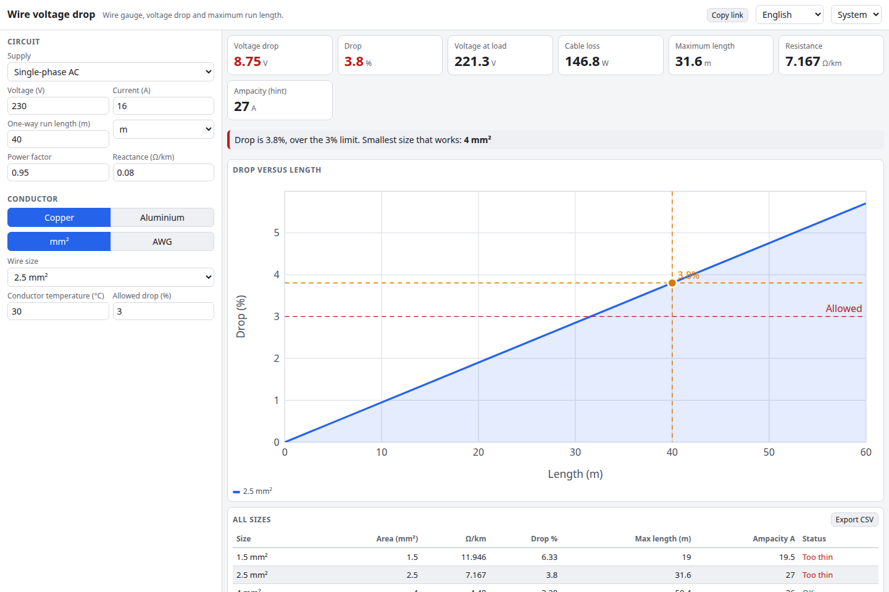

# Wire Voltage Drop Calculator

Pick a wire size, a load and a run length, and see the voltage drop, the voltage left at the load, the power lost in the cable and the longest run that stays inside your drop limit. Works in AWG or mm², copper or aluminium, with the conductor temperature, for DC, single-phase and three-phase circuits.

**Try it: [hermes98761234.github.io/wire-voltage-drop](https://hermes98761234.github.io/wire-voltage-drop/)**

[](https://github.com/hermes98761234/wire-voltage-drop/actions/workflows/deploy.yml)



## Features

- **AWG and mm²** sizes, with the AWG diameter and area computed from the standard formula.
- **Copper and aluminium** resistivity corrected for conductor temperature.
- **DC, 1-phase and 3-phase** drop, with optional power factor and reactance for AC.
- **Maximum length** for a chosen percentage drop, and the smallest size that meets it.
- **Ampacity hint** (IEC 60364 method C / NEC 75 °C) with a warning when the current is too high.
- **Chart and table** of drop versus length and of every standard size; CSV export and a share link.
- **Metric or imperial lengths, English or Ukrainian, light or dark.** Settings stay in the browser.

## How it works

Resistance per metre is rho(T) / A, with rho(T) = rho20 (1 + alpha (T - 20)). Copper uses 0.017241 ohm mm²/m and alpha 0.00393, aluminium 0.028264 and 0.00403. The drop is k I (R cos(phi) + X sin(phi)) L, with k = 2 for DC and single-phase (out and back) and k = sqrt(3) for three-phase. The maximum length solves the same equation for L. Ampacity values are typical reference figures and only a hint: derating for grouping, ambient and insulation is up to you and the local code.

## Quick start

You need [Node.js](https://nodejs.org/) 22.

```bash
git clone https://github.com/hermes98761234/wire-voltage-drop.git
cd wire-voltage-drop
npm install
npm run dev       # http://localhost:5173
npm test          # unit tests for the calculation library
npm run build     # static site in dist/
```

## License

MIT
